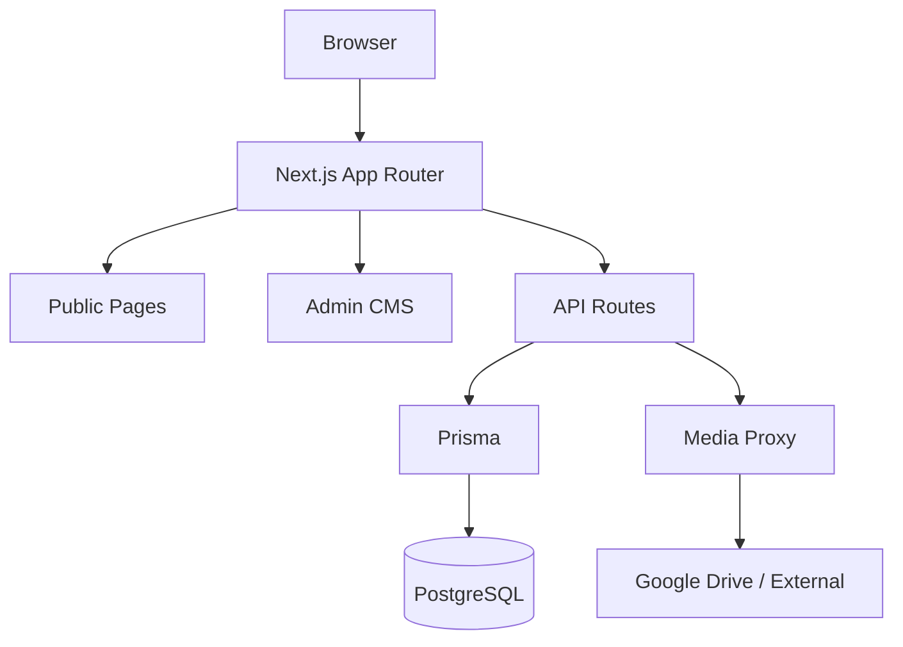

# ACD Studio Website

Next.js (App Router) + Prisma + TypeScript website for ACD Studio.

## Architecture

## Structure

- `app/` — routes (public, admin, API)
  - `app/(public)/` — customer-facing pages
  - `app/admin/` — CMS admin pages
  - `app/api/` — API routes
- `components/` — UI components
- `lib/` — utilities (Prisma, media, catalog, auth, storage)
- `prisma/` — schema & migrations
- `public/` — static assets

## Scripts

- `npm run dev` — dev server
- `npm run build` — production build
- `npx tsc --noEmit` — typecheck

## Env

See `.env`.
