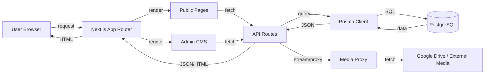
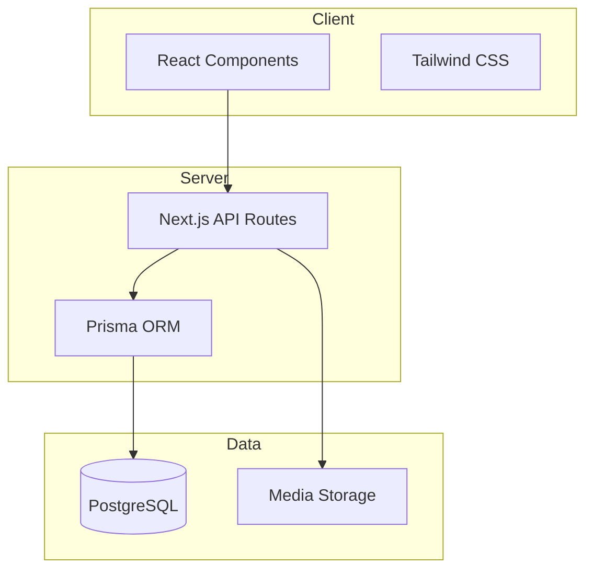

# ACD Studio Website

Next.js (App Router) + Prisma + TypeScript website for ACD Studio.

## Tech Stack

- **Frontend**: Next.js 14, React, Tailwind CSS, TypeScript
- **Backend**: Next.js API Routes (Node.js runtime)
- **Database**: PostgreSQL via Prisma ORM
- **Media**: Google Drive / external, proxied via `/api/media/stream`
- **Auth**: Cookie/JWT-based (getCurrentUser)
- **Payments**: payOS integration

## Architecture & Data Flow

## Layered Stack

## Design Thinking

- Single source of truth in PostgreSQL via Prisma.
- Media (images/videos) proxied through `/api/media/stream` to handle Drive hotlink/CORS.
- Admin CMS manages products, media, orders, users; public site consumes the same data.
- Product thumbnail distinguishes image vs video via `thumbnailIsVideo` flag.

## Structure

- `app/` — routes (public, admin, API)
  - `app/(public)/` — customer-facing pages
  - `app/admin/` — CMS admin pages
  - `app/api/` — API routes
- `components/` — UI components
- `lib/` — utilities (Prisma, media, catalog, auth, storage)
- `prisma/` — schema & migrations
- `public/` — static assets

## Scripts

- `npm run dev` — dev server
- `npm run build` — production build
- `npx tsc --noEmit` — typecheck

## Env

See `.env`.
